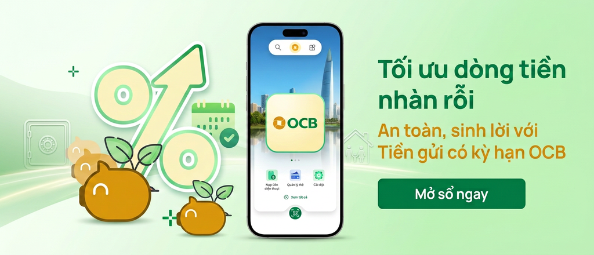

# Project 06 - Banner Generation (Multi-model Image GenAI, LangGraph pipeline, FastAPI backend, Streamlit webapp)

## Project Overview

This project demonstrates the design and development of a **Dynamic Creative Optimization (DCO)
banner generation system**: marketing/design teams describe a banner in a single `request.json`
(product or campaign, target segment, available assets, text to show, banner format), and the
system turns it into several ready-to-compare banner designs using **Image GenAI models**
instead of manual design work.

The solution covers the full lifecycle of a GenAI application: request schema design, design-guideline
retrieval, prompt construction, parallel multi-model image generation, post-processing (safe-area
crop), automated output validation + repair, REST API, a review/release webapp, and a pytest-based
evaluation suite.

Key highlights of the project include:
- Prompt pipeline orchestrated as a **LangGraph** workflow (request -> assets -> guideline -> image prep -> prompt)
- **Multi-model image generation** (Gemini, GPT-Image-2, MAI-Image, FLUX) behind one provider registry
- Swappable **text-LLM layer** (OpenAI / Claude / Llama / DeepSeek / Ollama) via config only
- Generate -> **validate -> repair** loop and safe-area aware cropping for production-size banners
- **Release & Clone** workflow: pick the best version, then reuse it as a reference to produce other banner sizes
- Full audit trail: every prompt actually sent to a model is stored next to its output image

## Primary Project Points

- Designed a strict nested `request.json` schema (pydantic) describing canvas, safe area, output size,
  assets, text, and design options, and built a guideline lookup keyed by `format_type`.

- Built a LangGraph pipeline that assembles **one shared prompt** (brief + design guideline + design rules +
  downsampled reference images) and reuses it across every model and version of a run.

- Implemented a provider layer for 7 image models and a separate, swappable text-LLM layer
  (`BaseLLMProvider` + `LLMFactory`) used for prompt refinement, design-technique selection and text generation.

- Added quality control for generated banners: safe-area guide images, post-generation validation and targeted
  repair, prompt-bleed guard, and automatic canvas planning for non-standard aspect ratios.

- Made the run resilient: one failed (model, version) never crashes the batch, every exception is logged,
  and HTTP calls use retry + timeout settings.

- Exposed the system through a FastAPI service and a Streamlit webapp, containerized with a multi-stage
  Docker image and `docker-compose`.

- Debugged real-run issues found during testing (e.g. the `uvicorn --reload` self-restart loop, cwd-dependent
  path resolution, `.env` keys silently not matching settings fields); all findings are recorded in the change log.

## Tech Stack

- **Programming Language**
  - Python 3.11

- **Orchestration & LLM**
  - LangGraph (pipeline and generate/validate/repair graphs)
  - GPT-5-mini (default text LLM, swappable: OpenAI / Claude / Llama / DeepSeek / Ollama)

- **Image GenAI Models**
  - Gemini-3.1-flash-image, Gemini-3-pro-image (Vertex AI)
  - GPT-Image-2 (Azure OpenAI)
  - MAI-Image-2.5 / -Flash / -Pro, FLUX.2-Pro (Azure AI Foundry)

- **API & Application**
  - FastAPI + Uvicorn (REST API)
  - pydantic / pydantic-settings (schemas and centralized config)
  - Streamlit (review, release and clone webapp)
  - Pillow (image preparation, crop, guide rendering)

- **Containerization**
  - Docker (multi-stage build), docker-compose (backend + webapp + optional Ollama)

- **Testing**
  - pytest (unit / smoke / stress tiers, all model calls mocked)

- **Storage**
  - File-based state (`input/`, `output/`, `config/`) and a small SQLite usage log - no database server

## Architecture Overview

```
request.json --> [LangGraph pipeline] --> shared prompt --> per (model, version) --> crop --> output/*.png
                  1 load_request            (built once,       generate_image()        |
                  2 resolve_assets           cached, reused)   + validate / repair     |
                  3 load_guideline                                                     v
                  4 prepare_images                                      output/<request>/prompt/*.txt  (audit log)
                  5 build_prompt (optional LLM refine)

Streamlit webapp --HTTP--> FastAPI (app/api/routes.py) --> app/core/pipeline.py --> app/providers/* (image)
                                                                               \--> app/llm/*       (text)
```

**User Interface**

  - Streamlit webapp: pick a request, choose a run mode, compare generated versions, release one, clone it to other sizes.

**API Layer**

  - FastAPI endpoints: `/health`, `/models`, `/requests`, `/generate`, `/outputs/*`, `/release`, `/clone`, `/clone-from-release`, `/files`.

**Pipeline Layer (`app/core/`)**

  - LangGraph builds the shared prompt once per run; the `model x version` loop runs outside the graph so one failure stays isolated.
  - Guideline lookup, asset resolver, image downsampling, safe-area guide, technique selector, canvas planner, output validator, usage tracker.

**Model Layer**

  - `app/providers/`: image-generation clients behind a registry (`prompt, attachments, width, height -> image bytes`).
  - `app/llm/`: generic text-LLM abstraction (`generate(prompt) -> str`), swappable through `.env`.

**Run modes** (`config/model_usage.json`): `default` / `quality` / `eco` / `custom` / `all`.
At the time of the last change-log entry all modes resolve to `gemini-3.1-flash-image`; the other models stay wired in the registry.

---

## Execution Result

Sample banners generated by the pipeline from `request.json` files (final, cropped output):

| Passport debit card - 1024x440 | Term deposit - 1024x440 |
|---|---|
|  |  |


Sample request files are in [`input/`](input/) (4 of the original request set).

**Note:**

The images above are a small selection of outputs from development runs. Brand guideline documents, logos, reference
imagery and the full set of request files used during development are intentionally **not** included in this public
repository (see "Assets not included" below).

---

## Project Structure

```
06_banner_generation_Nov2026/
├── README.md
├── docs/                       project description, technote, evaluation, change log, architecture notes
├── app/
│   ├── main.py                 FastAPI entrypoint
│   ├── settings.py             pydantic-settings Settings (single config source)
│   ├── api/routes.py           every endpoint the webapp calls
│   ├── models/schemas.py       request.json pydantic models
│   ├── core/                   pipeline, prompt builder, guidelines, validators, post-processing
│   ├── llm/                    swappable text-LLM layer (openai/claude/llama/deepseek/ollama)
│   ├── providers/              image-model clients + registry
│   └── evaluation/             pytest suite (unit / smoke / stress)
├── webapp/                     Streamlit frontend
├── config/                     model_usage.json, model_profiles.json, design technique catalogs
├── prompts/                    design rules + prompt templates
├── lib/                        guideline JSON, personas, safe-area guides, prompt catalogs
├── input/                      sample request.json files
├── script/                     env check, request validation, batch helpers
├── images/                     result screenshots used in this README
├── Dockerfile, docker-compose.yml
└── .env.example                config template (no secrets)
```

## How to Run

```bash
cp .env.example .env              # fill in real credentials (never commit .env)
pip install -r requirements.txt
python script/check_env.py        # sanity-check config, no API cost

# Terminal 1 - backend
uvicorn app.main:app --reload --reload-dir app --host 0.0.0.0 --port 8000

# Terminal 2 - frontend
streamlit run webapp/Home.py
```

Or with Docker: `docker compose up`.

`--reload-dir app` matters: without it `uvicorn --reload` watches `input/`, `output/` and `lib/`, which the app writes to
constantly, and the server restarts itself mid-request (symptom: `ConnectionResetError` in the frontend).

```bash
pip install -r requirements-dev.txt
pytest                # unit + smoke tiers (model calls are mocked)
pytest -m stress -v   # optional stress tier
```

### Assets not included

The original project depends on client brand assets (design-guideline images, logo, reference imagery, the full
request set). They are excluded here. The app does not crash without them: a missing asset is logged and generation
continues using the `format_type` guideline text. To reproduce full-quality results, provide your own assets under `lib/`
and your own request files under `input/`.

The smoke and stress test tiers rely on a fixture request (`input/DB_NOTI_AUTOPAY_NOEL.json`) that is not part of this
repository, so only the self-contained unit tier is expected to run as-is.

The documents in `docs/` were written during development and refer to this folder as `version_1/`.

---

# Project Execution Plan

---

## Work Package 01: Backend Foundation

### Task 1: Request schema & guidelines
- Define the nested `request.json` schema (`generation.canvas`, `generation.safe_area`, `output.size`, assets, text, design options)
- Guideline lookup by `format_type`, with shared `general_guide` rules

### Task 2: Pipeline & providers
- LangGraph pipeline building one shared prompt per run
- Provider registry for Gemini / GPT-Image-2 / MAI-Image / FLUX; swappable text-LLM layer
- Output manager: naming conventions, prompt audit log, raw (pre-crop) + final image

---

## Work Package 02: Quality Hardening on Real Runs

### Task 1: Safe-area control
- Safe-area guide images attached to the prompt, guideline margin rewriting, product-containment guard
- Aspect-ratio table fix for Gemini (root cause of stretched images before crop)

### Task 2: Validate & repair
- Post-generation validation, targeted repair and retry
- Canvas planner for non-standard sizes; prompt-bleed guard

### Task 3: Design technique selection
- Technique catalogs per brand style, LLM-based technique selector with a content-hash cache

---

## Work Package 03: Application & Delivery

### Task 1: API and webapp
- FastAPI endpoints for generate / outputs / release / clone
- Streamlit pages for review, release and clone to other sizes

### Task 2: Evaluation & packaging
- pytest tiers (unit / smoke / stress) with mocked model calls
- Multi-stage Dockerfile and `docker-compose.yml`
- Change log with measured results and root-cause notes: [`docs/4-project-evaluation-results.md`](docs/4-project-evaluation-results.md)

---

## Documentation

- [`docs/1-project_description.md`](docs/1-project_description.md) - what and why, scope, assumptions
- [`docs/2-project-technote.md`](docs/2-project-technote.md) - architecture, directory tree, `Settings` reference, run / build / deploy
- [`docs/3-project-evaluation.md`](docs/3-project-evaluation.md) - test methodology (unit / smoke / stress)
- [`docs/4-project-evaluation-results.md`](docs/4-project-evaluation-results.md) - change log with real measured results

# END
