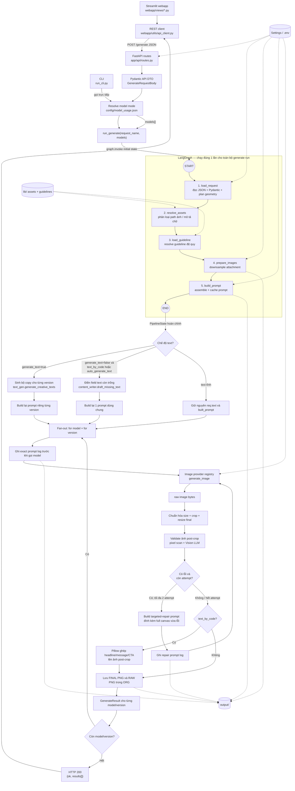
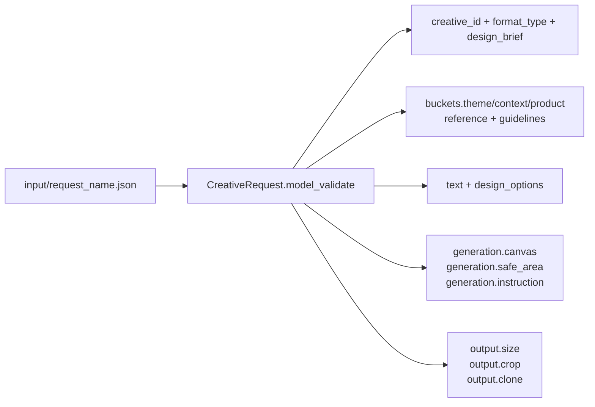
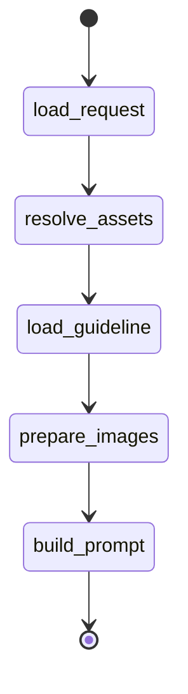
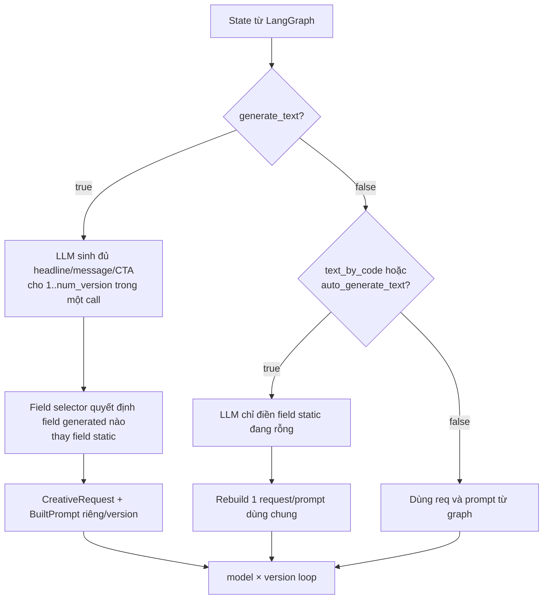
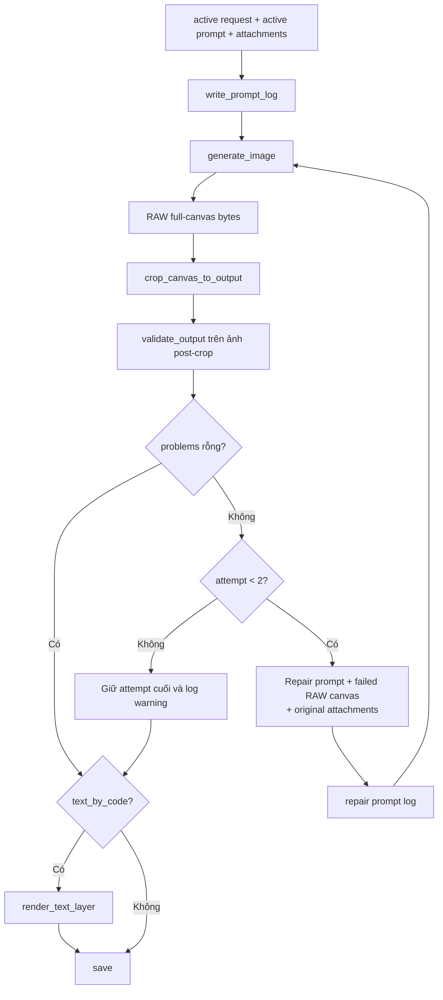
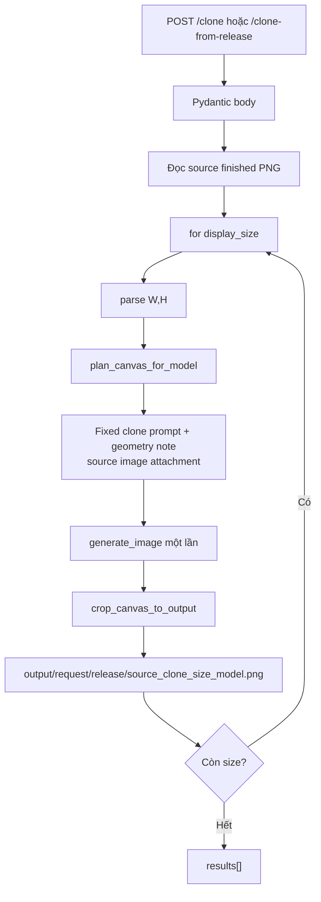
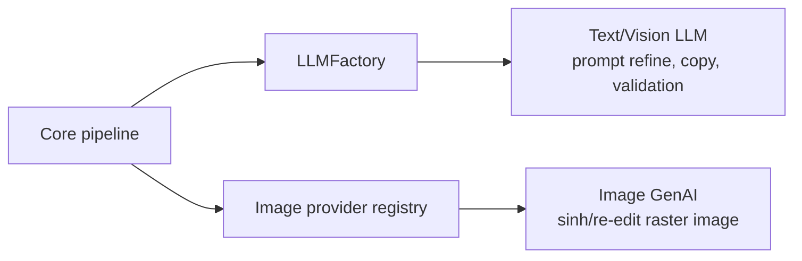

# Backend Block Diagram — DCO Dynamic Creative Opt (`version_2h`)

Tài liệu này mô tả **luồng runtime thực tế** của backend, được đối chiếu từ
toàn bộ mã nguồn Python trong `app/`, entrypoint CLI, REST client của webapp,
schema, config và test liên quan. Trọng tâm là input đi vào đâu, state được
biến đổi qua từng block như thế nào, chỗ nào dùng LangGraph, chỗ nào gọi LLM
hoặc Image GenAI, và dữ liệu/file nào được tạo ra.

> Kết luận quan trọng: LangGraph chỉ điều phối **5 block chuẩn bị** từ đọc
> request đến build prompt. Sinh ảnh, crop, validate, targeted repair, ghép
> chữ và lưu output chạy trong vòng lặp Python thường **sau `graph.invoke()`**.

---

## 1. Sơ đồ block tổng thể của backend



### Cách đọc sơ đồ

- Mũi tên liền là control/data flow chính.
- Mũi tên nét đứt là dependency hoặc side effect đọc/ghi file.
- Khung `LangGraph` là graph thật được compile trong
  `app/core/pipeline.py::build_graph()`.
- Vòng repair quay lại block Image GenAI nhưng **không quay lại LangGraph**.
- `POST /generate` là synchronous/blocking ở FastAPI. Webapp chạy lời gọi này
  trong background thread và đồng thời poll `/outputs/{request_name}` để hiện
  ảnh đã ghi ra đĩa.

---

## 2. Input contract và bước nhập hệ thống

Backend có hai lớp input cho một generate run:

1. API/CLI input chọn **request** và **model mode**.
2. File `input/<request_name>.json` chứa creative contract đầy đủ.

### 2.1 API input

```json
{
  "request_name": "MKT_SLIDE1_1_1024x440",
  "mode": "default",
  "custom_models": []
}
```

`GenerateRequestBody` validate ba field này. `model_usage.resolve_models()`
đọc `config/model_usage.json` và biến `default|quality|eco|custom|all` thành
`models[]`, loại trùng nhưng giữ thứ tự. Trong config hiện tại, các mode chuẩn
đều resolve về `gemini-3.1-flash-image`; registry vẫn hỗ trợ thêm các provider
khác cho custom mode.

### 2.2 Creative request input



Ý nghĩa các nhóm field quan trọng:

| Nhóm | Vai trò runtime |
|---|---|
| `creative_id` | Thành phần tên file output; nếu đường dẫn quá dài, backend dùng SHA-256 rút gọn. |
| `format_type` | Khóa lookup trong `lib/guidelines/guidelines.json` và chọn text-generation prompt template. |
| `design_brief` | Creative direction chính, đi vào prompt ảnh và các prompt sinh copy. |
| `buckets.*` | Mỗi item có đuôi ảnh được coi là asset path; item không có đuôi ảnh được coi là mô tả chữ. |
| `reference` | Ảnh reference tổng quát, luôn được xử lý như image path. |
| `guidelines` | Ảnh guideline bổ sung ở request level; nếu resolve được thì có thể thành attachment. |
| `text` | Headline, message, CTA label và deep link. |
| `design_options` | Điều khiển person/logo, sinh text, ghép text bằng code, màu chủ đạo, số decoration, design techniques. |
| `generation.canvas` | Kích thước yêu cầu Image GenAI sinh; có thể bị auto-plan lại trong memory. |
| `generation.safe_area` | Vùng content quan trọng; là fallback crop box nếu `output.crop.area` vắng mặt. |
| `output.size` | Kích thước PNG cuối cùng và là nguồn sự thật khi auto-plan geometry. |
| `output.crop` | Crop box tường minh từ full canvas sang final output. |
| `output.clone` | Danh sách kích thước cho flow clone, không dùng trong generate thường. |

Pydantic được cấu hình bỏ qua field thừa legacy; bucket string đơn được chuẩn
hóa thành list; headline/message dạng list được nối thành chuỗi nhiều dòng.

---

## 3. LangGraph: state và 5 node xử lý

Graph dùng `StateGraph(PipelineState)`, tuyến tính hoàn toàn, không có
conditional edge, parallel node hay checkpoint/persistence.



`_GRAPH` được lazy compile một lần trong process qua `_get_graph()`. Mỗi run
gọi graph bằng initial state:

```python
{"request_name": request_name, "models": models}
```

State tăng dần như sau:

```text
request_name, models
  + req, canvas_plan?
  + resolved_assets
  + guideline
  + prepared_images
  + built_prompt
```

### Block 1 — `load_request`

| Thuộc tính | Chi tiết |
|---|---|
| Hàm | `_node_load_request()` → `load_request_json()` → `plan_request_geometry()` |
| Đọc | `input/<request_name>.json`, `state.models` |
| Xử lý | `json.loads` rồi `CreativeRequest.model_validate`. Sau đó lấy `output.size` làm nguồn sự thật để cân nhắc canvas native ratio. |
| Auto geometry | Chỉ chạy khi mọi model được chọn có cùng bảng ratio đã biết. Runtime hiện chỉ khai báo bảng ratio cho `gemini-3.1-flash-image` trực tiếp trong `canvas_planner.py`. |
| Kết quả | `state.req`; thêm `state.canvas_plan` nếu auto-plan thành công. |
| Side effect | Chỉ log; không sửa file JSON gốc. |
| Lỗi | File thiếu, JSON lỗi hoặc schema lỗi làm `graph.invoke()` fail; `run_generate()` chuyển thành result lỗi thay vì làm crash API process. |

Auto-plan chọn ratio gần nhất bằng khoảng cách log-ratio, tạo canvas native
nhỏ nhất chứa trọn `output.size`, đặt final rectangle ở giữa rồi cập nhật bản
sao request trong memory: `generation.canvas`, `generation.safe_area` và
`output.crop`.

> `config/model_ratio.json` hiện **không được runtime import**. Bảng ratio có
> hiệu lực nằm trong `_MODEL_RATIO_BUCKETS` của `app/core/canvas_planner.py`.

### Block 2 — `resolve_assets`

| Thuộc tính | Chi tiết |
|---|---|
| Hàm | `_node_resolve_assets()` → `asset_resolver.resolve_assets()` |
| Đọc | `req.buckets`, `req.reference`, `req.guidelines`, `Settings.asset_library_dir` |
| Phân loại | Suffix `.png/.jpg/.jpeg/.webp/.gif/.bmp/.tif/.tiff` → image path; còn lại → free-text description. |
| Resolve | Image path được ghép dưới `lib/` hoặc `ASSET_LIBRARY_DIR` rồi kiểm tra tồn tại. |
| Kết quả | `ResolvedBucketAssets`: path ảnh theo từng bucket, text description theo từng bucket, reference, guideline_extra và danh sách trạng thái resolve cho UI. |
| Lỗi mềm | Asset thiếu được log warning và bỏ qua; pipeline tiếp tục. Một path bị gõ sai nhưng vẫn có suffix ảnh không bị hiểu nhầm thành mô tả chữ. |

### Block 3 — `load_guideline`

| Thuộc tính | Chi tiết |
|---|---|
| Hàm | `_node_load_guideline()` → `guidelines.resolve_guideline()` |
| Đọc | `req.format_type`, `lib/guidelines/guidelines.json` |
| Xử lý | BFS từ entry `format_type`, theo `general_guide` đệ quy, có `seen` chống cycle và giữ thứ tự. |
| Kết quả | `ResolvedGuideline`: tên entry, combined text, guideline image paths, missing entries. |
| Lưu ý | Các guideline screenshot resolve được nhưng pipeline chủ động **không gửi chúng** tới Image GenAI để tránh model sao chép ruler/frame/margin. Combined text vẫn được đưa vào prompt. |
| Lỗi mềm | File/entry/source thiếu hoặc JSON guideline lỗi chỉ log và trả guideline rỗng/thiếu. |

### Block 4 — `prepare_images`

| Thuộc tính | Chi tiết |
|---|---|
| Hàm | `_node_prepare_images()` → `image_prep.prepare_attachments()` |
| Input ảnh | Theo thứ tự: theme → context → product → reference → request-level `guideline_extra`. |
| Không đưa vào | Guideline screenshots từ block 3 và visual safe-area guide. |
| Xử lý | Pillow load ảnh; giữ aspect ratio; giới hạn cạnh dài theo `attach_image_max_dim` (mặc định 1024). Ảnh có alpha → PNG; còn lại → JPEG quality mặc định 85. |
| Cache | `output/<request_name>/_resized_refs/<stem>__<source_mtime>.<ext>`. |
| Kết quả | `state.prepared_images[]` gồm label, source path, resized path, MIME type. |
| Lỗi mềm | Một ảnh decode/resize lỗi bị skip riêng, không dừng request. |

### Block 5 — `build_prompt`

| Thuộc tính | Chi tiết |
|---|---|
| Hàm | `_node_build_prompt()` → `prompt_builder.build_prompt()` |
| Input | `req`, guideline combined text, đúng thứ tự label của prepared attachments. |
| Xử lý chính | Ráp design brief, control flags, geometry/trim, full-bleed rule, attachment roles, text mode, logo/theme/person/product, multi-element composition, request instruction, guideline, design rules, decorative limit, design techniques và final reminders. |
| Text-by-code | Không đưa advertising copy cho image model; yêu cầu để vùng bên phải trống theo text profile. |
| Guideline sanitization | Loại geometry/measurement có nguy cơ bị vẽ thành artifact trước khi ghép vào prompt. |
| Optional LLM refinement | Chỉ chạy nếu setting bật **và request không crop**. Request có crop bỏ qua refinement để tránh LLM tái tạo từ ngữ “safe-zone/frame”. Lỗi LLM fallback về raw prompt. |
| Cache | SHA-256 của request/guideline/attachment labels/design technique inputs; ghi `output/<request_name>/_prompt_cache/built_prompt.json`. |
| Kết quả | `BuiltPrompt{text, cache_key, attachments_order, llm_refined}`. |

Thứ tự attachment trong prompt phải khớp chính xác thứ tự bytes gửi tới
provider; vì vậy graph build label list từ chính `PreparedImage[]`, không từ
request ban đầu.

---

## 4. Xử lý sau LangGraph: text mode và fan-out

Ngay đầu `run_generate()`, cache text cũ của request bị xóa để mỗi thao tác
Generate có một lượt copy mới. Sau graph, `PreparedImage` được đọc thành
`ImageAttachment{label, mime_type, data}`.



Ba chế độ:

- `generate_text=true`: `text_gen` chọn template theo `format_type`, yêu cầu
  một JSON chứa đủ copy cho mọi version. Ba cờ
  `generate_text_headline/message/cta_label` chỉ chọn field nào được sử dụng;
  field không chọn giữ text tĩnh. Parse/validation/cache lỗi thì fallback.
- `generate_text=false` và `text_by_code` hoặc `auto_generate_text`: LLM chỉ
  điền field đang trống, một lần dùng chung cho mọi version.
- Mặc định: dùng nguyên `text` tĩnh từ JSON.

---

## 5. Vòng sinh ảnh, validate và targeted repair

Mỗi cặp `(model, version)` có `try/except` độc lập. Một provider/version lỗi
không làm mất kết quả của các cặp còn lại.



### 5.1 Image provider dispatch

`app/providers/registry.py` route tên model sang adapter:

| Model name | Adapter |
|---|---|
| `gemini-3.1-flash-image`, `gemini-3-pro-image` | `gemini_image.py`, REST `generateContent`, ảnh đính kèm base64 inline. |
| `gpt-image-2` | `azure_openai_image.py`, generations hoặc multipart edits khi có attachment. |
| `mai-image-2.5`, `mai-image-2.5-flash`, `mai-image-2.5-pro`, `flux.2-pro` | `azure_generic_image.py`. |

Shared HTTP helper dùng timeout/retry exponential backoff, TLS theo OS trust
store; provider trả raw bytes hoặc ném `ProviderError`.

### 5.2 Crop/post-process

`crop_canvas_to_output()`:

1. Decode bytes bằng Pillow.
2. Nếu provider trả sai pixel size, resize về `generation.canvas`.
3. Clamp và crop theo `output.crop.area`, fallback `generation.safe_area`.
4. Resize vùng crop về đúng `output.size` nếu cần.
5. Encode PNG.

### 5.3 Validate

Validator chạy **trước** khi code ghép chữ:

- deterministic full-resolution scan tìm màu magenta của guide bị leak;
- Vision LLM so product đầu tiên với product reference;
- Vision LLM so context đầu tiên với context reference;
- phát hiện person không được phép khi không có context và
  `generate_person=false`;
- kiểm tra logo bắt buộc;
- kiểm tra text/asset bị clip hoặc sát output edge;
- phát hiện frame/ruler/measurement/hex token/standalone logo bị cấm;
- với `text_by_code`, kiểm tra model có tự vẽ chữ và có lấn vùng text bên
  phải hay không.

Nếu LLM provider không hỗ trợ vision hoặc call vision lỗi, check đó được
**skip**, không biến lỗi hạ tầng thành false rejection.

### 5.4 Targeted repair

Khi có problem và còn attempt:

- attachment số 1 là full canvas vừa sinh lỗi, trước crop;
- các attachment gốc hợp lệ được thêm lại;
- prompt yêu cầu giữ concept/background/style và chỉ sửa các lỗi đã liệt kê;
- text rule được đổi phù hợp với `text_by_code`;
- attempt tối đa là `_MAX_GENERATE_ATTEMPTS = 2` tổng cộng, không phải 2 retry;
- nếu attempt cuối vẫn lỗi, backend vẫn lưu ảnh cuối và trả `ok=true`, đồng
  thời ghi warning. Validation hiện là cơ chế repair/best-effort, không phải
  hard quality gate.

---

## 6. Ghép text bằng code

Chỉ chạy khi `design_options.text_by_code=true`, sau crop/validation và trước
lưu final image.

`text_compositor.render_text_layer()` chọn profile theo đúng `output.size`
(hiện có profile cho `1024x440` và `1024x256`), sau đó:

- xác định vùng text bên phải;
- đo độ sáng nền để chọn màu chữ phù hợp;
- load Manrope, fallback Segoe UI trên Windows;
- wrap và giảm font size để vừa max width/max lines;
- vẽ headline, message và CTA/button bằng Pillow;
- lỗi compositing trả lại ảnh không chữ thay vì fail toàn result.

Do text được ghép sau validate, validator chỉ đánh giá phần hình do image
model tạo và việc vùng dành cho chữ có được để trống hay không; nó không QA
lớp text Pillow cuối cùng.

---

## 7. Output và side effects

```text
output/<request_name>/
├── _resized_refs/                         # attachment đã downsample
├── _prompt_cache/built_prompt.json        # cache prompt assembly
├── _text_gen_cache/text_gen.json          # cache copy trong một generate run
├── prompt/
│   ├── prompt-<model>-version-<n>.txt
│   └── prompt-<model>-version-<n>-repair-<attempt>.txt
├── <WIDTH>x<HEIGHT>/<model>/
│   ├── <creative>_<size>_<model>_<timestamp>-v<n>.png   # FINAL
│   └── ORG/
│       └── cùng-tên-file.png                              # RAW attempt cuối
└── release/
    ├── file được copy để release
    └── <source>_clone_<size>_<model>.png
```

- Prompt ban đầu được log **trước** model call, nên provider fail vẫn còn dấu
  vết prompt.
- FINAL là ảnh đã crop và có thể đã ghép chữ bằng code.
- ORG là raw full canvas của attempt cuối, chưa crop, chưa ghép chữ.
- Timestamp có độ chính xác tới giây; nếu vẫn trùng, `-dupN` tránh overwrite.
- App log ghi ra stdout và rotating file `output/_logs/app.log`.

Response có một `GenerateResult` cho từng model/version:

```json
{
  "ok": true,
  "image_model": "gemini-3.1-flash-image",
  "version": 1,
  "display_size": "1024x440",
  "path": "...absolute path...",
  "filename": "...png",
  "error": null
}
```

`POST /generate` ở cấp route thường trả `{ "ok": true, "results": [...] }`
ngay cả khi một số item trong `results` có `ok=false`; `ok` ngoài cùng nói
route/orchestration đã trả response, còn success thực tế phải đọc từng item.

---

## 8. Flow Clone — không dùng LangGraph



`POST /clone` lấy size từ `req.output.clone`; `/clone-from-release` nhận size
trực tiếp từ body. Clone không chạy guideline, asset resolution, prompt cache,
text generation, output validation/repair hoặc text compositor. Mỗi size có
`try/except` riêng.

---

## 9. Release, listing và file serving

Các flow phụ quanh pipeline:

| Endpoint | Block backend | Chức năng |
|---|---|---|
| `GET /requests` | `list_requests()` | Liệt kê stem của `input/*.json`. |
| `GET /requests/{name}` | parse schema + `resolve_assets()` | Preview request và trạng thái asset cho UI; schema lỗi vẫn trả raw request kèm `schema_error`. |
| `GET /models` | model usage + provider registry | Trả provider biết tới và model groups hiện dùng. |
| `GET /outputs/{name}` | `list_new_images()` | Poll file final mới theo mtime; không quét ORG/cache/release. |
| `GET /outputs/{name}/latest` | `latest_run_images()` | Gom cụm output gần nhất theo khoảng cách mtime. |
| `POST /release` | `release_images()` | Copy final đã chọn vào `release/`, lỗi từng file độc lập. |
| `GET /release/{name}` | `list_released()` | Liệt kê PNG đã release. |
| `GET /files?path=...` | `FileResponse` | Serve file cho frontend sau khi kiểm tra resolved path thuộc allowlist. |

File serving kiểm tra allowlist **trước** existence để tránh path traversal và
rò rỉ thông tin tồn tại của file ngoài `output`, `input`, asset library và
guideline directory.

---

## 10. Phân biệt hai loại AI call



- `app/llm/*`: abstraction cho LLM text/vision. Provider mặc định `openai`
  có thể trỏ tới Azure GPT-5-mini; còn có Claude, DeepSeek, Llama, Ollama.
- `app/providers/*`: abstraction riêng cho Image GenAI. Đây mới là nơi sinh
  ảnh banner.
- Hai registry độc lập; `llm_model_name`/`llm_text_gen` không phải tên image
  model trong `model_usage.json`.

---

## 11. Error boundaries

| Phạm vi | Chính sách |
|---|---|
| LangGraph setup | Exception được bắt quanh `graph.invoke`; trả failure result cho mỗi model đã resolve. |
| Asset/guideline/prep | Phần tử lỗi thường được warning và skip; pipeline tiếp tục. |
| Prompt refine/copy LLM | Best-effort; fallback raw prompt hoặc static text. |
| Từng model/version | `try/except` riêng; append `GenerateResult(ok=false)` và chạy cặp tiếp theo. |
| Vision validate | Call lỗi được skip; không tạo problem giả. |
| Repair vẫn không đạt | Giữ attempt cuối và warning, không hard-fail result. |
| Lưu ORG lỗi | Không làm fail final image đã lưu. |
| Text compositor lỗi | Trả ảnh chưa ghép text. |

Điểm cần lưu ý khi vận hành: chính sách “never crash whole run” tăng khả năng
thu được partial result, nhưng client phải đọc `results[].ok`, log warning và
chất lượng ảnh; chỉ nhìn HTTP 200 hoặc top-level `ok` là chưa đủ.

---

## 12. Module hiện không nằm trên generate runtime path

Các file sau vẫn có code/test hoặc CLI độc lập, nhưng `run_generate()` hiện
không import/gọi chúng:

| Module/config | Trạng thái thực tế |
|---|---|
| `app/core/safe_area_guide.py` | Có thể tạo visual guide độc lập, nhưng `_node_prepare_images()` chủ động không attach guide. |
| `app/core/guideline_rewriter.py` | Utility rewrite guideline bằng LLM; prompt builder hiện sanitize guideline trực tiếp, không gọi utility này. |
| `app/core/prompt_bleed_guard.py` | Utility LLM containment cũ; không được gọi trong `build_prompt()`. |
| `config/model_ratio.json` | Có dữ liệu ratio nhưng runtime planner đang dùng constant hard-code trong `canvas_planner.py`. |

Các module này không nên được vẽ như block đang chạy trong production flow.
`output_validator.py` vẫn giữ magenta leak scan và một số wording lịch sử để
phòng artifact từ output/cache cũ.

---

## 13. Source map

| Trách nhiệm | Source chính |
|---|---|
| FastAPI bootstrap/routes | `app/main.py`, `app/api/routes.py` |
| Schema/input normalization | `app/models/schemas.py` |
| LangGraph + orchestration | `app/core/pipeline.py` |
| Geometry | `app/core/canvas_planner.py`, `app/core/image_post.py` |
| Asset/guideline | `app/core/asset_resolver.py`, `app/core/guidelines.py` |
| Attachment prep | `app/core/image_prep.py` |
| Prompt | `app/core/prompt_builder.py`, `app/core/design_techniques.py`, `app/core/color_utils.py` |
| Text | `app/core/text_gen.py`, `app/core/content_writer.py`, `app/core/text_compositor.py`, `app/core/text_style_profiles.py` |
| Validation/repair | `app/core/output_validator.py`, repair helpers trong `app/core/pipeline.py` |
| Image providers | `app/providers/registry.py`, provider adapters, `app/providers/_http.py` |
| LLM providers | `app/llm/factory.py`, `app/llm/providers/*` |
| Files/output/release | `app/core/output_manager.py` |
| Configuration/logging | `app/settings.py`, `app/logging_conf.py`, `config/*.json` |
| Frontend ingress/polling | `webapp/utils/api_client.py`, `webapp/views/*.py` |

