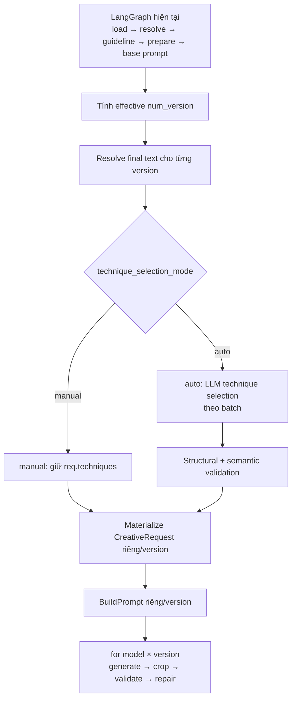

# Proposal v2 + Implementation — LLM tự động chọn Design Techniques theo từng Version

> **CẬP NHẬT 2026-09-09 (schema đã thay đổi, tài liệu dưới đây giữ nguyên làm
> lịch sử thiết kế):** `design_options.technique_selection_mode` (flat) +
> `design_options.techniques` (flat) mô tả trong tài liệu này đã được thay
> bằng một object lồng nhau `design_options.technique_selection`:
> ```json
> "technique_selection": {
>   "mode": "auto",
>   "manual_techniques": [],
>   "auto_config": {
>     "max_background_techniques": 3,
>     "max_product_techniques": 3,
>     "max_decoration_techniques": 3,
>     "selection_constraints": ["prompts/mkt_techniques_sel.txt"]
>   }
> }
> ```
> Quy tắc mode không đổi (`manual` dùng `manual_techniques`, bỏ qua hoàn toàn
> `auto_config`; `auto` bỏ qua hoàn toàn `manual_techniques`), chỉ đổi tên
> field chứa list manual. Điểm MỚI mà tài liệu bên dưới CHƯA mô tả (vì được
> thêm sau): (1) mỗi request tự khai báo max riêng cho từng group
> background/product/decoration qua `auto_config.max_*_techniques`, thay cho
> policy `max_per_group` cố định dùng chung của catalog; (2)
> `auto_config.selection_constraints` là list đường dẫn file (tính từ
> `./lib`, cùng convention với `buckets.*`/`guidelines`) — nội dung mọi file
> này được nạp và chèn vào prompt chọn technique của LLM làm hướng dẫn bắt
> buộc. Xem `app/models/schemas.py` (`TechniqueSelectionConfig`,
> `TechniqueAutoConfig`) và `app/core/technique_selector.py`
> (`_effective_group_max`, `_resolve_selection_constraints_text`) cho phần
> implementation hiện hành; mọi đoạn code mẫu/field name flat cũ trong tài
> liệu bên dưới chỉ còn giá trị lịch sử.

## 1. Trạng thái và quyết định đã thống nhất

Tài liệu này thay thế toàn bộ proposal trước đó và phản ánh bốn quyết định
mới nhất:

1. Mỗi group `background`, `decoration`, `product` được chọn **0–3
   techniques**, không bắt buộc phải có technique. Không được chọn một
   technique không phù hợp chỉ để đạt số lượng tối thiểu. **Không làm sai
   brief là MUST.**
2. `config/design_techniques.json` đã được nâng lên schema v2, làm giàu
   metadata, sửa nội dung/instruction, phân loại lại và mở rộng từ 29 lên 43
   techniques.
3. Thêm `design_options.technique_selection_mode`:
   - `manual`: sử dụng `design_options.techniques` như hiện tại;
   - `auto`: bỏ qua hoàn toàn giá trị trong `design_options.techniques`, LLM
     tự chọn từ toàn bộ catalog.
4. LLM xử lý tối đa 10 versions trong một call theo mặc định. Nếu nhiều hơn
   10, backend chia batch liên tiếp; batch size phải nằm trong `Settings` để
   thay đổi được bằng environment variable.

**Trạng thái triển khai (2026-09-06):** schema, typed catalog loader,
selector, deterministic validation, correction retry, safe fallback,
sequential batching, pipeline integration, selection artifacts và prompt
cache riêng/version đã được implement. Các hạng mục UI/benchmark ở Phase 4
vẫn là phần nâng cao, không nằm trong runtime contract cốt lõi.

---

## 2. Đánh giá khả thi

Giải pháp khả thi cao và phù hợp với flow hiện tại vì `run_generate()` đã có
cơ chế tạo `CreativeRequest` và `BuiltPrompt` riêng theo version khi sinh
text. Technique selection có thể dùng cùng pattern:

- LLM chọn key theo version;
- code kiểm tra output bằng Pydantic và metadata catalog;
- mỗi version nhận một bản request có `design_options.techniques` đã
  materialize trong memory;
- `build_prompt()` hiện tại tiếp tục resolve key và đưa canonical
  `prompt_instruction` vào image prompt;
- mọi image model của cùng version dùng chung một technique set;
- manual mode không thay đổi hành vi cũ.

| Hạng mục | Đánh giá sau khi có catalog v2 |
|---|---|
| Chọn 0–3 techniques/group | Khả thi và an toàn hơn policy 1–3 cũ |
| Technique riêng/version | Khả thi bằng request/prompt riêng/version |
| Đọc toàn catalog trong một LLM call | Khả thi với batch mặc định tối đa 10 versions |
| Backward compatibility | Đạt nếu mode mặc định là `manual` |
| Kiểm soát hallucination | Đạt bằng exact-key allowlist và deterministic validation |
| Audit/reproducibility | Đạt nếu lưu selection artifact, raw response và prompt log |
| Không làm sai brief | Có thể enforce bằng policy 0–3, precondition/conflict và fallback rỗng |

---

## 3. Catalog `design_techniques.json` v2 hiện tại

File hiện tại: `config/design_techniques.json`.

### 3.1 Quy mô catalog

| Group | Số lượng hiện tại | Phạm vi |
|---|---:|---|
| `background` | 13 | Nền, color field, lighting, spatial depth và cấu trúc backdrop chính |
| `decoration` | 17 | Accent phụ, motion, atmosphere, reward và motif theo dịp |
| `product` | 13 | Hero product/device/subject, typography và kỹ thuật tích hợp foreground |
| **Tổng** | **43** | Trước đây có 29 techniques |

Top-level catalog hiện có:

```json
{
  "schema_version": "2.0",
  "selection_policy": {
    "min_per_group": 0,
    "max_per_group": 3,
    "prefer_fewer_when_sufficient": true,
    "max_total_per_version": 6,
    "must_not_force_irrelevant_technique": true,
    "group_order": ["background", "decoration", "product"]
  },
  "group_definitions": {},
  "metadata_contract": {},
  "design_techniques": {}
}
```

`max_total_per_version=6` là guard chống biến 3 techniques/group thành chín
hiệu ứng cùng lúc. Selector vẫn được phép chọn 0–3 trong từng group, nhưng
tổng ba group không vượt quá 6. Ưu tiên chọn ít khi một technique đã đủ.

### 3.2 Metadata có trên mọi technique

Toàn bộ 43 entries hiện có đầy đủ:

| Field | Mục đích |
|---|---|
| `group` | Group chính xác dùng để validate selection |
| `label` | Tên chuyên môn dễ đọc |
| `description` | Giải thích ý đồ thiết kế |
| `keywords` | Từ khóa chuyên môn hỗ trợ LLM reasoning |
| `prompt_instruction` | Canonical production instruction gửi cho Gemini Image |
| `tags` | Mood, medium, subject và application signals |
| `occasion` | `generic` hoặc dịp cụ thể |
| `visual_density` | `low`, `medium`, `high` để tránh clutter |
| `preconditions` | Điều kiện phải có trước khi chọn |
| `avoid_when` | Trường hợp không nên chọn |
| `incompatible_with` | Conflict cứng; đã được lưu hai chiều |
| `works_well_with` | Pairing suggestion, không phải yêu cầu bắt buộc |
| `selection_notes` | Ghi chú chuyên môn bổ sung cho selector/reviewer |

`incompatible_with` hiện không có key hỏng và mọi quan hệ conflict đều đối
xứng. Selector phải coi metadata này là constraint, không chỉ là lời khuyên.

### 3.3 Techniques mới đã thêm

**Background:**

- `mesh_gradient_depth`
- `architectural_light_planes`
- `editorial_negative_space`

**Decoration generic:**

- `abstract_light_trails`
- `geometric_corner_accents`
- `soft_bokeh_sparkles`
- `organic_ribbon_flow`
- `glassmorphism_accent_shapes`
- `data_flow_accents`

**Product/foreground:**

- `hero_pedestal_stage`
- `controlled_contact_shadow`
- `layered_depth_overlap`
- `premium_reflection_glow`
- `product_scale_hierarchy`

Các decoration generic mới giải quyết vấn đề catalog cũ chỉ có motif ngày
lễ. Tuy vậy `0` vẫn là kết quả đúng khi không technique nào cải thiện thiết
kế hoặc canvas/brief không còn đủ visual budget.

### 3.4 Các thay đổi phân loại và nội dung

- `floating_reward_particles`: chuyển từ `background` sang `decoration`.
- `seasonal_corner_tag`: chuyển từ `product` sang `decoration`.
- `character_cutout_ground_shadow`: đổi label thành
  `Photographic Subject Cutout + Grounding Shadow`, làm rõ đây là kỹ thuật
  tích hợp subject foreground và tuyệt đối không đổi identity/pose/realism.
- `outlined_headline_typography`: đổi label thành
  `Controlled Outline for AI-Rendered Headline`, cấm áp dụng khi
  `text_by_code=true`.
- Đã viết lại instruction cho các kỹ thuật có nguy cơ tạo frame, vignette,
  text sai, UI bịa, product distortion hoặc quá nhiều reward particles.
- Giữ key legacy `silhoutte_watermark` để không phá request manual cũ; thêm
  alias đúng chính tả `silhouette_watermark`. Selector vẫn phải trả exact
  catalog key `silhoutte_watermark` cho tới khi có migration riêng.

### 3.5 Tương thích runtime hiện tại

`app/core/design_techniques.py` hiện chỉ đọc `label`, `description` và
`prompt_instruction`; các metadata v2 chưa ảnh hưởng manual runtime. Khi
implement auto selector, cần mở rộng loader bằng `TechniqueDefinition` hoặc
API trả raw catalog đã validate để selector đọc toàn bộ metadata.

---

## 4. API/schema được chốt

Thêm field vào `DesignOptions`:

```python
from typing import Literal

technique_selection_mode: Literal["manual", "auto"] = "manual"
techniques: list[str] = Field(default_factory=list)
```

### 4.1 Manual mode

```json
{
  "design_options": {
    "technique_selection_mode": "manual",
    "techniques": ["radial_spotlight", "controlled_contact_shadow"]
  }
}
```

Behavior:

- không gọi Technique Selector LLM;
- dùng `techniques` đúng như request hiện tại;
- unknown key tiếp tục bị skip và warning theo behavior hiện có;
- không tự áp policy 0–3 lên manual list, trừ khi sau này muốn thêm validation
  riêng. Manual được xem là explicit human override.

### 4.2 Auto mode

```json
{
  "design_options": {
    "technique_selection_mode": "auto",
    "techniques": ["this_value_is_ignored_in_auto_mode"]
  }
}
```

Behavior đã chốt:

- gọi Technique Selector LLM;
- **không đọc, không validate, không merge và không dùng làm fallback** bất kỳ
  giá trị nào trong `design_options.techniques`;
- LLM luôn chọn từ toàn bộ catalog v2;
- kết quả validated của LLM được ghi vào bản `CreativeRequest` trong memory
  cho từng version;
- file request JSON gốc không bị sửa;
- nếu auto selection fail, dùng safe fallback do code quyết định; tuyệt đối
  không quay lại list `techniques` của request.

Default `manual` bảo đảm request cũ không khai báo field mới vẫn hoạt động
y hệt trước đây.

---

## 5. Vị trí block mới trong flow

Giải pháp khuyến nghị vẫn là đặt selector trong phase `plan_versions()` sau
LangGraph hiện tại:



Lý do không thêm selector trực tiếp thành LangGraph node trong phase đầu:

- selector nên thấy final text theo version;
- text generation hiện nằm ngoài graph;
- graph hiện trả một `BuiltPrompt`, trong khi auto mode cần prompt
  riêng/version;
- ép node vào graph mà vẫn rebuild ngoài graph sẽ làm base prompt thừa và
  state khó hiểu.

Long-term có thể refactor `plan_versions()` thành LangGraph subgraph nếu cần
checkpoint/observability, nhưng không phải prerequisite của tính năng.

---

## 6. Version planning và thứ tự xử lý

Thứ tự bắt buộc:

1. Chạy graph để có request đã plan geometry, resolved assets, guideline và
   prepared attachment labels.
2. Tính `effective_num_version`, bao gồm `num_version_override` nếu có.
3. Resolve final text cho từng version:
   - generated text;
   - fill-missing text;
   - hoặc static text.
4. Nếu manual: giữ list technique từ request.
5. Nếu auto: gọi selector theo batch, truyền final text của từng version.
6. Validate và flatten selection theo thứ tự group:
   `background → decoration → product`.
7. Tạo `CreativeRequest` riêng cho mọi version với final text + final
   technique keys.
8. Build prompt riêng/version.
9. Dùng prompt/version đó cho mọi image model.

Việc chọn technique sau text giúp quyết định đúng các trường hợp như numeric
badge, AI-rendered headline, UI callout và `text_by_code`.

---

## 7. Batching: tối đa 10 versions mỗi LLM call

### 7.1 Settings mới

Thêm vào `app/settings.py`:

```python
technique_selection_batch_size: int = Field(default=10, ge=1)
```

Environment variable do `pydantic-settings` tự map:

```text
TECHNIQUE_SELECTION_BATCH_SIZE=10
```

Không hard-code `10` trong selector/pipeline. Mọi batching phải đọc
`get_settings().technique_selection_batch_size`.

### 7.2 Quy tắc batch

Với batch size mặc định 10:

| `num_version` | LLM calls | Version trong từng call |
|---:|---:|---|
| 1–10 | 1 | `1..N` |
| 11 | 2 | `1..10`, `11` |
| 20 | 2 | `1..10`, `11..20` |
| 21 | 3 | `1..10`, `11..20`, `21` |

Pseudo-code:

```python
batch_size = settings.technique_selection_batch_size
for start in range(1, num_version + 1, batch_size):
    version_ids = range(start, min(start + batch_size, num_version + 1))
    batch_result = select_batch(version_ids, prior_selection_summary)
    selections.update(batch_result)
```

### 7.3 Diversity xuyên batch

Call thứ hai không nhìn thấy reasoning đầy đủ của call đầu nếu chạy độc lập.
Để tránh duplicate nguyên bộ:

- sau mỗi batch, tạo compact `prior_selection_summary` chỉ gồm version ID và
  selected key sets;
- gửi summary này vào batch kế tiếp;
- yêu cầu batch mới không lặp nguyên signature đã dùng khi còn phương án phù
  hợp khác;
- không gửi lại rationale dài để tránh prompt tăng tuyến tính quá mạnh;
- overlap một technique tốt giữa các version vẫn được phép.

Nên chạy batch tuần tự để call sau nhận summary call trước. Không chạy song
song nếu cross-batch diversity là yêu cầu.

### 7.4 Failure isolation

- validate từng batch riêng;
- invalid batch được correction retry một lần;
- batch fail không làm mất selection hợp lệ của batch trước;
- chỉ các version trong batch fail nhận safe fallback;
- generation của toàn run vẫn tiếp tục.

---

## 8. Technique Selector LLM

### 8.1 Persona bắt buộc

System prompt đề xuất:

> You are a Senior Marketing Design Director and art-direction expert for
> professional banking campaigns. Select a restrained, coherent set of
> production techniques that strengthens the brief, respects supplied assets
> and brand constraints, and avoids visual clutter. You must reason about
> compatibility, prerequisites, hierarchy, medium, audience, occasion, final
> aspect ratio, and the relationship between all selected techniques. Never
> select an irrelevant technique merely to fill a category.

### 8.2 Context gửi cho LLM

Mỗi batch nhận:

- toàn bộ 43 catalog entries và metadata v2;
- selection policy từ chính config, không copy hard-code vào nhiều nơi;
- `creative_id`, `format_type`, `design_brief`;
- final text của từng version;
- bucket roles, filenames và free-text descriptions;
- trạng thái có/không product, context, reference, logo;
- `generate_person`, `text_by_code`, `dominant_color`;
- `num_decorative_elements`;
- generation canvas, output size, crop và aspect ratio;
- guideline text đã sanitize hoặc compact guideline summary;
- prior selection summary nếu đây không phải batch đầu.

Phase đầu dùng text-only LLM. Nếu filename/bucket description không đủ để
biết asset có phải phone/person/card hay không, phase sau có thể thêm một
Vision LLM asset-summary step; không cần thiết để triển khai MVP.

### 8.3 Hard selection rules

- Chỉ trả exact key từ `design_techniques`.
- Mỗi group chọn từ 0 tới 3.
- Tổng số không vượt `selection_policy.max_total_per_version`.
- `0` là lựa chọn đúng nếu không có technique phù hợp.
- Không chọn technique có unmet `preconditions`.
- Không chọn khi một `avoid_when` rõ ràng đúng.
- Không chọn hai key có `incompatible_with`.
- Tôn trọng occasion, visual density và `num_decorative_elements`.
- Không chọn nhiều chỉ để tạo diversity hoặc dùng hết quota.
- Set tổng thể phải coherent, không phải tập effect rời rạc.
- Không làm sai brief, locked asset, text, logo/person rule hoặc geometry.

---

## 9. Structured output

LLM chỉ trả JSON cho đúng version IDs của batch:

```json
{
  "versions": {
    "1": {
      "background": ["editorial_negative_space", "mesh_gradient_depth"],
      "decoration": ["abstract_light_trails"],
      "product": ["controlled_contact_shadow"],
      "cohesion_summary": "A restrained premium composition with a quiet copy zone and one directional accent.",
      "rationale": {
        "background": "...",
        "decoration": "...",
        "product": "..."
      }
    },
    "2": {
      "background": ["tech_pattern_overlay"],
      "decoration": ["data_flow_accents"],
      "product": [],
      "cohesion_summary": "A digital-first variant; no product treatment was added because the supplied product is already visually complete.",
      "rationale": {
        "background": "...",
        "decoration": "...",
        "product": "No compatible product technique improves the brief."
      }
    }
  }
}
```

Internal output phải dùng Pydantic. `cohesion_summary` và `rationale` chỉ để
audit; không gửi sang Image GenAI. LLM selector chỉ chọn key, còn canonical
`description` và `prompt_instruction` luôn được đọc lại từ catalog.

---

## 10. Validation

### 10.1 Structural validation

- Có đúng mọi version ID của batch, không thừa/thiếu.
- Có đủ ba group; list rỗng là hợp lệ.
- Mỗi group có 0–3 unique key.
- Tổng key không vượt max total.
- Mọi key tồn tại trong catalog.
- Key nằm đúng group catalog.
- Không duplicate giữa các group.

### 10.2 Semantic validation

- Tất cả precondition được đáp ứng hoặc có evidence hợp lý.
- Không vi phạm `avoid_when`.
- Không có conflict pair.
- Occasion-specific technique chỉ được chọn khi brief/request có occasion.
- `text_by_code=true` chặn technique yêu cầu Image GenAI vẽ typography.
- Không có person/device/product treatment khi subject tương ứng không tồn
  tại hoặc không được phép sinh.
- Visual density và decoration không vượt budget.
- Không chọn technique làm thay đổi locked asset.
- Signature version không lặp nguyên bộ khi còn lựa chọn phù hợp khác.

Metadata dùng natural-language chuyên môn nên một số semantic check cần kết
hợp LLM reasoning và rule code rõ ràng. Các rule chắc chắn như key/group,
conflict, occasion, text mode và count phải deterministic.

### 10.3 Retry

Mỗi batch tối đa 2 attempts:

1. selection call ban đầu;
2. correction call nhận raw JSON cũ và danh sách validation errors.

Correction prompt chỉ được sửa selection JSON, không được sửa catalog hoặc
creative brief.

---

## 11. Fallback — MUST không làm sai brief

Thứ tự fallback cho một batch auto bị lỗi:

1. Chạy deterministic safe selection nếu code chứng minh được precondition và
   không có conflict.
2. Group nào không chứng minh được technique phù hợp thì dùng `[]`.
3. Nếu không có technique nào an toàn, toàn version dùng ba list rỗng.
4. Không dùng `request.design_options.techniques` trong auto mode, kể cả làm
   fallback.
5. Không fail toàn generate run chỉ vì selector lỗi.

Kết quả/log phải có status:

```text
auto_selected | corrected | fallback | empty_safe_fallback | failed
```

`empty_safe_fallback` tốt hơn ép holiday/product effect sai context. Đây là
cách enforce yêu cầu “không được làm sai brief”.

---

## 12. Cache, artifact và reproducibility

Đề xuất lưu:

```text
output/<request_name>/_technique_selection/
├── technique_selection.json
├── batch-001-versions-001-010.json
├── batch-002-versions-011-020.json
└── ...
```

Aggregate artifact nên chứa:

- selections/rationale/status theo version;
- selector provider/model;
- configured batch size;
- request hash và catalog SHA-256;
- effective `num_version`;
- batch boundaries và attempt count;
- timestamp;
- validation warnings;
- raw LLM responses nếu không chứa secret.

Policy khuyến nghị:

- selection mới cho mỗi explicit Generate run;
- reuse trong mọi image model thuộc cùng run;
- batch artifact phục vụ debug;
- aggregate artifact ghi request hash, catalog SHA-256, provider/model và
  batch size để nhận diện chính xác input/config của selection run.

Prompt cache cũ chỉ có `built_prompt.json`. Implementation đã thêm
`cache_variant` để các version không ghi đè hoặc reuse nhầm cache của nhau:

```text
_prompt_cache/built_prompt-v1.json
_prompt_cache/built_prompt-v2.json
...
```

---

## 13. Thay đổi code đã triển khai

| File | Thay đổi |
|---|---|
| `app/models/schemas.py` | Thêm `technique_selection_mode`, default `manual`; thêm DTO nội bộ cho batch selection nếu đặt chung schema. |
| `app/settings.py` | Thêm `technique_selection_batch_size=10`. |
| `app/core/design_techniques.py` | Thêm typed catalog definition và expose metadata v2; giữ `resolve_techniques()` tương thích manual. |
| `app/core/technique_selector.py` | Module mới: prompt, batching, parse, validate, retry, fallback, artifact. |
| `app/core/pipeline.py` | Resolve text trước, chạy selector trong auto mode, materialize request/prompt riêng/version. |
| `app/core/output_manager.py` | Path cho selection artifacts và versioned prompt cache. |
| `app/core/prompt_builder.py` | Hỗ trợ cache variant; có thể thêm coherence header cho selected techniques. |
| `app/api/routes.py` | Không bắt buộc đổi request body; có thể trả selection summary trong results ở phase sau. |
| `app/evaluation/unit/*` | Unit/integration tests mới. |

Không cần sửa Image Provider adapters. Gemini vẫn nhận prompt canonical do
`_design_techniques_text()` tạo.

---

## 14. Pseudocode tích hợp

```python
state = graph.invoke({"request_name": request_name, "models": models})
base_req = state["req"]
num_version = resolve_effective_num_version(base_req, num_version_override)

version_reqs = resolve_final_text_requests(base_req, num_version)

if base_req.design_options.technique_selection_mode == "auto":
    # Intentionally ignore base_req.design_options.techniques completely.
    selections = select_techniques_batched(
        request_name=request_name,
        version_reqs=version_reqs,
        guideline=state["guideline"],
        resolved_assets=state["resolved_assets"],
        batch_size=settings.technique_selection_batch_size,
    )
    for version in range(1, num_version + 1):
        keys = selections[version].flatten(
            group_order=("background", "decoration", "product")
        )
        version_reqs[version] = with_techniques(version_reqs[version], keys)
# manual: version_reqs already retain request.design_options.techniques

version_prompts = {
    version: build_prompt(
        request_name,
        version_reqs[version],
        state["guideline"],
        attachment_labels,
        cache_variant=f"v{version}",
    )
    for version in range(1, num_version + 1)
}

for model in models:
    for version in range(1, num_version + 1):
        generate_with_repair(
            model=model,
            req=version_reqs[version],
            prompt=version_prompts[version],
            attachments=attachments,
        )
```

---

## 15. Image prompt behavior

Không cho selector tự viết rendering instruction. Sau selection:

1. code flatten exact keys;
2. `resolve_techniques()` đọc canonical content từ config;
3. `_design_techniques_text()` chèn instruction vào image prompt;
4. instruction vẫn chịu mọi request JSON, locked asset, text, logo/person,
   safe-area, full-bleed và MUST/MUST NOT rule.

Nên thêm header:

> The techniques below form one coherent art-direction set for this version.
> Combine only their compatible aspects into a unified composition. Do not
> demonstrate them as separate effects, do not add content merely to prove a
> technique was used, and omit any optional aspect that would conflict with
> the brief or locked assets.

Policy `0–3/group`, `max_total=6` và `prefer_fewer_when_sufficient` giúp giảm
nguy cơ Gemini biến technique list thành checklist hiệu ứng.

---

## 16. Test plan

### Catalog tests

- schema version và selection policy hợp lệ;
- mọi entry đủ metadata;
- group chỉ thuộc ba giá trị hỗ trợ;
- conflict reference tồn tại và đối xứng;
- occasion technique không bị đánh dấu generic sai;
- label không trùng;
- alias không trở thành output key ngoài catalog.

### Selector unit tests

- parse batch có list rỗng hợp lệ;
- accept 0–3/group, reject >3;
- reject tổng >6;
- reject unknown/wrong-group/duplicate/missing-version;
- reject conflict, unmet precondition, occasion mismatch;
- `text_by_code` chặn AI typography;
- correction retry;
- safe empty fallback;
- auto mode không đọc manual techniques;
- manual mode không gọi LLM.

### Batching tests

- 1, 10 versions → 1 call;
- 11, 20 versions → 2 calls;
- 21 versions → 3 calls;
- custom batch size từ Settings được áp dụng;
- exact version IDs không thiếu/trùng;
- prior selection summary đi vào batch sau;
- một batch fail không làm mất batch trước;
- selector call count độc lập với số image models.

### Pipeline tests

- request cũ mặc định manual và prompt không đổi ngoài các canonical catalog
  instruction đã chủ động cập nhật;
- prompt riêng/version chứa đúng technique set;
- cùng version, mọi image model nhận cùng prompt/techniques;
- generated text được resolve trước selector;
- exact prompt log phản ánh selection thật;
- fallback vẫn chạy image generation.

### Quality evaluation

Benchmark nên bao gồm generic, premium, fintech, product-card, device/app,
person, no-product, `text_by_code`, Tết, Noel và canvas hẹp/rộng. Chấm:

- brief fit;
- technique coherence;
- version diversity;
- visual clutter;
- locked-asset compliance;
- prompt conflict rate;
- validation/repair rate;
- auto selection so với manual baseline.

---

## 17. Trạng thái lộ trình triển khai

### Phase 1 — Schema và catalog runtime — Hoàn thành

1. Thêm `technique_selection_mode` default manual.
2. Thêm setting batch size mặc định 10.
3. Mở rộng typed catalog loader cho schema v2.
4. Thêm catalog integrity tests.

### Phase 2 — Selector — Hoàn thành

1. Tạo `technique_selector.py`.
2. Một call cho tối đa batch size versions.
3. Structured output, validation và correction retry.
4. Sequential batching + prior-selection summary.
5. Safe/empty fallback.

### Phase 3 — Pipeline integration — Hoàn thành

1. Chuẩn hóa `version_reqs` cho mọi text mode.
2. Auto selection bỏ qua manual list.
3. Build/cache prompt riêng/version.
4. Ghi aggregate/batch artifacts.

### Phase 4 — Evaluation và nâng cao — Tùy chọn/tiếp tục theo dữ liệu production

- expose selection summary cho UI;
- Vision asset summary nếu cần;
- benchmark/tune prompt và metadata;
- theo dõi technique nào thường dẫn tới repair;
- cân nhắc LangGraph subgraph cho version planning.

---

## 18. Acceptance criteria cuối cùng

1. Request cũ không khai báo mode mới chạy ở `manual`.
2. Manual mode dùng đúng `design_options.techniques`, không gọi selector.
3. Auto mode bỏ qua hoàn toàn `design_options.techniques`.
4. Selector đọc catalog v2 tại runtime, không hard-code technique trong code.
5. Mỗi version có 0–3 techniques/group và tổng không vượt policy catalog.
6. Không technique nào được ép chọn khi không phù hợp.
7. Không vi phạm precondition, occasion hoặc conflict đã biết.
8. Mỗi version có một art-direction set riêng; overlap hợp lý được phép.
9. Cùng version dùng cùng set cho mọi image model.
10. Tối đa 10 versions/call mặc định; `Settings` thay đổi được batch size.
11. Nhiều hơn batch size được chia đủ batch, không thiếu/trùng version.
12. LLM chỉ chọn exact key; canonical instruction luôn đến từ config.
13. Batch/selector lỗi không làm crash generate run.
14. Fallback không dùng manual list trong auto mode và được phép trả set rỗng.
15. Có artifact và prompt log để truy vết mọi quyết định.
16. Generic campaign không bị gắn holiday decoration sai brief.

---

## 19. Kiến trúc được khuyến nghị

Giải pháp cuối cùng nên triển khai là:

- catalog v2 hiện có 43 techniques và metadata compatibility;
- `manual/auto` explicit, default `manual`;
- `auto` tuyệt đối không care giá trị `techniques` trong JSON;
- 0–3 techniques/group, tối đa tổng 6, được phép chọn 0;
- final text trước, technique selection sau;
- một LLM call cho tối đa 10 versions;
- version >10 chia batch tuần tự theo setting;
- gửi compact prior-selection summary sang batch kế tiếp;
- LLM đóng vai Senior Marketing Design Director;
- LLM chỉ chọn key, code validate, canonical instruction lấy từ config;
- request/prompt riêng/version, dùng chung cho mọi image model;
- correction retry một lần, sau đó deterministic/empty safe fallback;
- block version planning mới nằm trong `run_generate()` ngoài LangGraph ở
  phase đầu; LangGraph defer prompt assembly trong auto mode cho đến khi
  final text và technique set của từng version đã được chốt.

Thiết kế này đáp ứng yêu cầu sáng tạo theo version nhưng vẫn giữ nguyên tắc
quan trọng nhất: **technique là công cụ hỗ trợ brief; không bao giờ được làm
sai brief chỉ để lấp đầy một group hoặc tạo khác biệt hình thức giữa các
version.**
